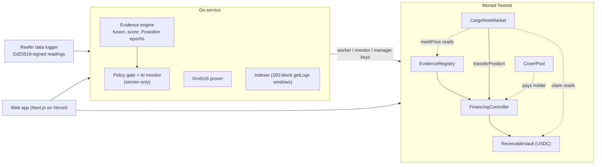

<p align="center">
  
</p>

<h3 align="center">Cargo Notes: trade finance positions that are priced by the cargo's own evidence</h3>

<p align="center"><b>Monad Metropolis · Track 01: Onchain Finance &amp; Trading</b></p>

<p align="center">
A financier's USDC reaches an exporter milestone by milestone, only when the container's signed sensor evidence clears
an on-chain policy. The financier's position in that facility is a <b>Cargo Note</b>, a new asset: it can be bought
and sold mid-voyage on an on-chain order book, and its reference price is marked on chain to the latest evidence the
cargo committed. When the buyer pays, settlement goes to whoever holds the note.
</p>

<p align="center">
  <a href="https://cargoflow-monad.vercel.app"></a>
  <a href="#deployed-contracts-monad-testnet-10143"></a>
  <a href="#tests"></a>
  
  
</p>

## Links

| What | Where |
|---|---|
| **Live app** | [cargoflow-monad.vercel.app](https://cargoflow-monad.vercel.app) · trading at [/notes](https://cargoflow-monad.vercel.app/notes) |
| **API** | [cargoflow-monad-api.onrender.com/v1/health](https://cargoflow-monad-api.onrender.com/v1/health) (free tier: the first request after idle takes ~1 min to wake) |
| **Live on-chain run** | [`docs/runs/monad-testnet.md`](docs/runs/monad-testnet.md): 22 linked transactions, including a ZK recovery and a Cargo Note trade |
| **Contracts** | [MonadVision](https://testnet.monadvision.com/address/0x120142b2e5A90F2676F41d8d20bDCC94C66ec55d) (all 11 source-verified via Sourcify) · [manifest](contracts/deployments/monad-testnet.json) |
| **Track** | Track 01 · Onchain Finance & Trading; optional sponsor fit: Kuru "Bring New Assets and Markets" |

### For judges: try it in two minutes

1. Add Monad Testnet (chain 10143, RPC `https://testnet-rpc.monad.xyz`) to any EVM wallet; get MON from [faucet.monad.xyz](https://faucet.monad.xyz) and USDC from [faucet.circle.com](https://faucet.circle.com) (choose Monad Testnet).
2. Open [/notes](https://cargoflow-monad.vercel.app/notes): every funded facility is listed with its evidence score, claim at settlement, on-chain mark, ask and best bid, re-read every second.
3. Bid on a note (approve, then place bid: your USDC is escrowed by the market and can be withdrawn at any time), or open a shipment from the [fleet](https://cargoflow-monad.vercel.app/shipments) and follow its evidence, releases and pauses live.
4. To create your own shipment end to end: [/exporter](https://cargoflow-monad.vercel.app/exporter) registers it, [/financier](https://cargoflow-monad.vercel.app/financier) funds it, [/buyer](https://cargoflow-monad.vercel.app/buyer) pays it. Each portal signs from the connected wallet; no test credentials are needed.

## The problem

The Asian Development Bank puts the global trade finance gap at
[$2.5 trillion in 2025, with 41% of SME applications rejected](https://www.adb.org/news/demand-trade-finance-rise-amid-supply-chain-realignment-adb-report).
In India half of B2B sales are on credit with [52-day average terms](https://group.atradius.com/knowledge-and-research/reports/b2b-payment-practices-trends-india-2025),
and biopharma loses [about $35 billion a year](https://www.aircargonews.net/pharma-logistics/2019/07/failures-in-temperature-controlled-logistics-cost-biopharma-industry-billions/)
to temperature-control failures in transit. A lender advancing money against a reefer container sees paperwork, not
the container, so it lends blind or does not lend.

There is a second problem nobody solves: **a trade-finance position is illiquid until the buyer pays.** A financier
who funds a 52-day voyage is locked in for 52 days, with no way to exit, rebalance or price the risk as the voyage
unfolds. That is why the capital stays small and expensive.

## What CargoFlow does

```
SIGNED SENSOR READINGS → EVIDENCE SCORE (on chain) → MILESTONE RELEASES → CARGO NOTE MARK → TRADES → SETTLEMENT TO THE HOLDER
```

1. **Evidence-gated capital.** The exporter registers a shipment and a commit-reveal cold-chain policy (2-8 °C,
   score ≥ 75, humidity and shock limits). The financier escrows USDC in a `ReceivableVault`. The container's data
   logger signs every reading; eight readings per probe close an epoch whose salted Poseidon root and 0-100 score
   (Dempster-Shafer fusion of the probes) are committed on chain. A milestone releases its tranche only if the
   `FinancingController` itself re-checks the committed epoch against the on-chain policy.
2. **Pause and zero-knowledge recovery.** An excursion pauses the facility. Once the unaffected probe has eight fresh
   in-band readings, a Groth16 proof (bound to this chain, controller, shipment, pause count and submitter) resumes it
   without revealing a single reading.
3. **Settlement with title.** The buyer's single payment runs the waterfall (principal + fee to the financier,
   residual to the exporter) and hands over the electronic bill of lading (ERC-721) in the same transaction.
4. **New on Monad: Cargo Notes.** The financier's position (principal + fee + undrawn at settlement, the escrowed title
   on default, any accepted insurance cover) is now transferable, and `CargoNoteMarket` gives it a market:
   - **Order book:** one ask per note and any number of USDC-escrowed bids; `buy` and `acceptBid` move the position
     through the controller atomically with the payment.
   - **On-chain evidence mark:** `markPrice` = undrawn escrow at par + (drawn principal + fee) × (1 − 0.5% per score
     point below 100), × 0.7 while paused. It is computed from the vault and the latest committed epoch, so it moves
     the moment the cargo's evidence does. Trades happen at the prices traders choose; the mark makes them legible.
   - **Everything follows the note:** settlement, default payouts, the bill of lading and cover pay the current holder
     (`CoverPool` reads the holder at payout). A note cannot be sold to the exporter or buyer, or while disputed.

### Why this needs Monad

A Cargo Note's fair value changes every time the cargo commits evidence: every few minutes per shipment, across a
whole fleet. Marking, quoting and trading those positions on chain only works if updating them is near-free and
final in under a second. On Monad (400 ms blocks, ~800 ms finality) the `/notes` book re-reads every block, a
trader sees an excursion hit the mark before a human could react, and a fill is final before the next sensor
reading arrives. The same flow on a slow or expensive chain collapses back into an off-chain spreadsheet.

Monad also gives CargoFlow, unchanged: the **P-256 precompile** at `0x100` (verified on chain 10143) for passkey
payments from ZeroDev Kernel smart accounts (EntryPoint v0.7, Kernel v3.1 and the WebAuthn validator are all
deployed on Monad Testnet), and contract size headroom for the full controller.

## Who it is for

- **First user (financier side):** an NBFC or trade-finance desk in India funding pharmaceutical exporters
  (India's pharma exports were [USD 30.47 billion in FY 2024-25](https://www.pib.gov.in/PressReleasePage.aspx?PRID=2231234), shipped at 2-8 °C).
  Cargo Notes let it recycle capital mid-voyage instead of being locked for 52 days.
- **Note buyers:** credit funds and treasury desks that want short-dated, self-liquidating, USDC-denominated yield
  whose risk they can watch block by block.
- **Exporter:** a Pune vaccine exporter shipping via Nhava Sheva to Singapore, who gets cash per milestone instead of
  waiting two months.

This market doesn't exist today because nobody could see the collateral. Once the container's evidence is on chain,
the position becomes priceable, and once it is priceable it can trade.

## Live on Monad Testnet

A full shipment ran end to end on 13 October 2026: register → policy → facility → deposit → transit → two evidence-gated
releases → reefer failure (score 48) → automatic pause → Groth16 recovery → release → **Cargo Note sold mid-voyage at 1%
under the mark** → milestones 4-5 → delivery → settlement **paid to the note holder**. Every transaction is linked in
[`docs/runs/monad-testnet.md`](docs/runs/monad-testnet.md).

### Deployed contracts (Monad Testnet, 10143)

All source-verified on MonadVision (Sourcify). Settlement token: Circle USDC on Monad Testnet.

| Contract | Address |
|---|---|
| CargoNoteMarket (new) | [`0x120142b2e5A90F2676F41d8d20bDCC94C66ec55d`](https://testnet.monadvision.com/address/0x120142b2e5A90F2676F41d8d20bDCC94C66ec55d) |
| FinancingController | [`0x172f8B86a9368ef729fa76c773ECA03d166DEB4d`](https://testnet.monadvision.com/address/0x172f8B86a9368ef729fa76c773ECA03d166DEB4d) |
| ReceivableVault | [`0x5298dCdBDf6EC799475B09c2Ecd0f089bD4D6902`](https://testnet.monadvision.com/address/0x5298dCdBDf6EC799475B09c2Ecd0f089bD4D6902) |
| EvidenceRegistry | [`0x4aD47799586B4793b7952BA849013F5D0eC2e66a`](https://testnet.monadvision.com/address/0x4aD47799586B4793b7952BA849013F5D0eC2e66a) |
| ShipmentRegistry | [`0x2f7cAc603654eC106dA242cD0b16044b31f7608d`](https://testnet.monadvision.com/address/0x2f7cAc603654eC106dA242cD0b16044b31f7608d) |
| PolicyEngine | [`0x93f2cd67f404f62Ff34F729aad1118ea9e1582d0`](https://testnet.monadvision.com/address/0x93f2cd67f404f62Ff34F729aad1118ea9e1582d0) |
| Groth16Verifier | [`0x1BAa24a99A9Fe8Cd53feB30E5dF098D1334E0a8D`](https://testnet.monadvision.com/address/0x1BAa24a99A9Fe8Cd53feB30E5dF098D1334E0a8D) |
| CoverPool | [`0x8E8e19744C9066320509b5c9acD50AC092837083`](https://testnet.monadvision.com/address/0x8E8e19744C9066320509b5c9acD50AC092837083) |
| EBLRegistry (bill of lading, ERC-721) | [`0xA2E708376CDDf0eb8fa746c43089611B4d49E210`](https://testnet.monadvision.com/address/0xA2E708376CDDf0eb8fa746c43089611B4d49E210) |
| DeviceRegistry | [`0x88188585DF01F73C5f6c9c646651Bc0b3fb622d9`](https://testnet.monadvision.com/address/0x88188585DF01F73C5f6c9c646651Bc0b3fb622d9) |
| CargoFlowAccess (roles) | [`0x5Ed4f105E3c3C0a67f916c0fc339B261E3De81d7`](https://testnet.monadvision.com/address/0x5Ed4f105E3c3C0a67f916c0fc339B261E3De81d7) |
| USDC (Circle, testnet) | [`0x534b2f3A21130d7a60830c2Df862319e593943A3`](https://testnet.monadvision.com/address/0x534b2f3A21130d7a60830c2Df862319e593943A3) |

## Architecture



The chain is the financial source of truth; Postgres holds operational evidence (readings, epochs, audit trail). See
[`docs/architecture.md`](docs/architecture.md) for the state machine, the authority matrix (what each role *cannot*
do) and trust boundaries.

| Layer | Stack |
|---|---|
| Contracts | Solidity 0.8.28, Foundry, OpenZeppelin 5.4; immutable, no proxies |
| ZK | Circom 2.2 + Groth16 (snarkjs), proof bound to the contract's own public signals |
| Backend | Go: ingestion, Dempster-Shafer evidence engine, idempotent chain outbox, reorg-safe indexer, REST + WebSocket |
| Frontend | Next.js 16 on Vercel, wagmi/viem, passkeys via ZeroDev Kernel |
| Packages | `@cargoflow/sdk`, `@cargoflow/mcp` (Claude connector), `@cargoflow/gateway` (logger agent), Python SDK |

## Run it locally

```bash
git clone --recursive https://github.com/LSUDOKO/CargoFlow-Monad && cd CargoFlow-Monad
cp .env.example .env                       # Monad RPC, USDC address, role keys
make contracts-test                        # 379 Foundry tests
docker run -d -p 5434:5432 -e POSTGRES_USER=cargoflow -e POSTGRES_PASSWORD=cargoflow-local-only -e POSTGRES_DB=cargoflow postgres:17
make migrate && make serve                 # backend against Monad Testnet
cd frontend && pnpm install && pnpm dev    # http://localhost:3000
# a full on-chain lifecycle with a note trade:
NOTE_TRADE=1 FACILITY_USDC=4 INVOICE_USDC=7 npx tsx frontend/scripts/testnet-lifecycle.ts http://127.0.0.1:8090
```

Deploy your own: `BROADCAST=1 ./scripts/deploy-testnet.sh` (pins 102 gwei; ~2 MON), `./scripts/testnet-fund.sh`,
`./scripts/verify-testnet.sh`.

## Tests

| Suite | Count |
|---|---|
| Contracts (unit, fuzz, invariants, real-proof integration), incl. 13 for Cargo Notes | 379 passing |
| Frontend unit (vitest), incl. the off-chain mark mirroring `markPrice` | 300 passing |
| Backend (Go) | all packages pass except `devicetrust`, whose PEM test roots are not committed |
| Circuits | parity with the Go and Solidity implementations |

## What changed for Monad

- Retargeted every layer to Monad Testnet (10143): chain config, explorer (MonadVision), Alchemy network, SDK, MCP, scripts.
- Settlement in Circle USDC on Monad Testnet; contracts are unchanged in that respect (6-decimal ERC-20).
- **New:** `IPositionTransfer` on the controller, `ReceivableVault.transferFinancier`, `EvidenceRegistry.latestEpochId`,
  `CoverPool` paying the current holder, and `CargoNoteMarket` with the on-chain evidence mark; the `/notes` trading UI.
- Indexer windows `eth_getLogs` to 100 blocks (Monad public RPC limit); deploy script pins Monad gas pricing.
- Fixed a restart bug: rebuilding a shipment's pipeline after a ZK recovery epoch.

## Path forward

| Next | Exit test |
|---|---|
| Liquidity: seed asks/bids on every new facility from a market-maker vault | every live note has a two-sided quote |
| Kuru integration: list Cargo Notes (as ERC-20 wrappers per note) on Kuru's order book | first note traded on Kuru |
| Pilot: one Indian pharma exporter and one NBFC funding 10 shipments | 10 facilities settled, ≥ 3 notes traded mid-voyage |
| Audit + public ZK ceremony | report published |
| Monad mainnet with real USDC | first outside financier |

Target: $1M in notes outstanding within six months of mainnet, at a planned 30-50 bps protocol fee on financed volume
plus 10 bps on note trades.

## License

MIT. See [LICENSE](LICENSE). Built for Monad Metropolis; this repository ports and extends
[CargoFlow](https://github.com/LSUDOKO/CargoFlow) to Monad.
