<p align="center">
  <picture>
    <source media="(prefers-color-scheme: dark)" srcset="frontend/public/brand/logo-dark.svg">
    
  </picture>
</p>

<h3 align="center">Evidence-gated working capital, and Cargo Notes that trade on it</h3>

<p align="center"><b>Monad Metropolis · Track 01: Onchain Finance &amp; Trading</b></p>

<p align="center">A financier's USDC reaches the exporter milestone by milestone, only when the cargo's own signed sensor evidence clears an on-chain policy. On Monad, the financier's position becomes a <b>Cargo Note</b>: a new asset that trades mid-voyage on an on-chain order book, marked block by block to the cargo's latest evidence. The buyer's single payment settles whoever holds the note and hands over the bill of lading.</p>

<p align="center">
  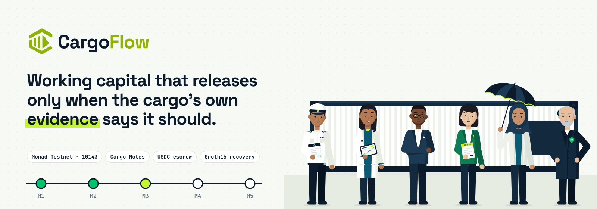
</p>

<p align="center">
  <a href="https://cargoflow-monad.vercel.app"></a>
  <a href="#deployed-contracts-source-verified"></a>
  <a href="https://testnet.monadvision.com"></a>
  <a href="#cargo-notes-the-new-primitive"></a>
  <a href="#measured-not-claimed"></a>
  <a href="#use-cargoflow-in-claude"></a>
  <a href="LICENSE"></a>
</p>

<p align="center">
  
  
  
  
  
  
</p>

## All links

Everything in one place.

| What | Link | Notes |
|---|---|---|
| **Hackathon** | Monad Metropolis | Track 01 · Onchain Finance & Trading; sponsor fit: Kuru, Envio, MetaMask Agent Wallet, Alchemy ([integrations](#sponsor-and-partner-integrations)) |
| **Live app** | [cargoflow-monad.vercel.app](https://cargoflow-monad.vercel.app) | Connect any wallet on Monad Testnet (10143); no test credentials needed |
| **Cargo Notes** | [/notes](https://cargoflow-monad.vercel.app/notes) | The order book: evidence mark, claim, ask, best bid, upside; re-read every block |
| **Portals** | [exporter](https://cargoflow-monad.vercel.app/exporter) · [financier](https://cargoflow-monad.vercel.app/financier) · [buyer](https://cargoflow-monad.vercel.app/buyer) · [carrier](https://cargoflow-monad.vercel.app/ebl) · [market](https://cargoflow-monad.vercel.app/market) · [arbiter](https://cargoflow-monad.vercel.app/arbiter) | Every action is a transaction the party signs |
| **Fleet** | [/shipments](https://cargoflow-monad.vercel.app/shipments) | Every shipment, with its live dashboard |
| **API** | [cargoflow-monad-api.onrender.com/v1/health](https://cargoflow-monad-api.onrender.com/v1/health) | REST and WebSocket; [OpenAPI 3.1](https://cargoflow-monad-api.onrender.com/v1/openapi.json). Free tier: the first request after idle can take about a minute |
| **API docs** | [/docs](https://cargoflow-monad.vercel.app/docs) | Interactive reference with every wallet-signed message format |
| **Contracts** | [/deployments](https://cargoflow-monad.vercel.app/deployments) · [manifest](contracts/deployments/monad-testnet.json) | All source-verified on [MonadVision](https://testnet.monadvision.com) (Sourcify) |
| **Live run** | [`docs/runs/monad-testnet.md`](docs/runs/monad-testnet.md) | 22 linked transactions: ZK recovery, a Cargo Note trade, settlement paid to the note holder |
| **MCP server URL** | `https://cargoflow-monad-mcp.adoranto737.workers.dev/mcp` | Remote MCP (Streamable HTTP), 25 tools, holds no keys |
| **Submission kit** | [`docs/submission`](docs/submission/README.md) | Logo, judge access steps, [video script](docs/submission/VIDEO-SCRIPT.md) |
| **Docs index** | [`docs/README.md`](docs/README.md) | Architecture, backend, packages, runbooks, security, protocol knowledge base |
| **Role guides** | [`docs/guides`](docs/guides/README.md) | [Exporter](docs/guides/exporter.md) · [financier](docs/guides/financier.md) · [buyer](docs/guides/buyer.md) · [carrier](docs/guides/carrier.md) · [arbiter](docs/guides/arbiter.md) |

## At a glance

A financier locks USDC in a shipment-specific escrow facility. Tranches release only when multi-source sensor
evidence satisfies an on-chain policy. An anomaly pauses the facility, a context-bound zero-knowledge proof of
secondary evidence resumes it, and the buyer's single invoice payment repays the financier, pays the exporter the
rest and hands the buyer the electronic bill of lading, in one transaction.

**New on Monad:** the financier's position is a **Cargo Note**. It can be sold mid-voyage on `CargoNoteMarket` (asks,
escrowed bids, atomic fills), wrapped into an ERC-20 and listed on **Kuru**'s order book, indexed by **Envio**, and
traded by an agent through a **MetaMask Agent Wallet** plugin. Its reference price is computed on chain from the vault
and the latest evidence epoch, so the market moves the moment the cargo does.

```
PHYSICAL REALITY → SIGNED EVIDENCE → ON-CHAIN SCORE → RELEASES → CARGO NOTE MARK → TRADES → SETTLEMENT TO THE HOLDER
```

> [!NOTE]
> **Live on Monad Testnet (10143), settling in Circle USDC.** This repository ports and extends
> [CargoFlow](https://github.com/LSUDOKO/CargoFlow) to Monad. Cargo Notes, the note market, the ERC-20 note wrapper and
> its Kuru market, the Envio indexer, the agent-wallet plugin and the Monad-specific fixes are new for Metropolis.

## Contents

| Story | Product | Engineering |
|---|---|---|
| [The problem in one paragraph](#the-problem-in-one-paragraph) | [Cargo Notes, the new primitive](#cargo-notes-the-new-primitive) | [Architecture](#architecture) |
| [Meet the cast](#meet-the-cast) | [Product tour](#product-tour) | [Live on Monad Testnet](#live-on-monad-testnet) |
| [How it works, in twelve beats](#how-it-works-in-twelve-beats) | [Use CargoFlow in Claude](#use-cargoflow-in-claude) | [Under the hood](#under-the-hood) |
| [Why CargoFlow is fundable](#why-cargoflow-is-fundable) | [For developers](#for-developers) | [Sponsor integrations](#sponsor-and-partner-integrations) · [Measured](#measured-not-claimed) · [What's next](#security-and-whats-next) |
| [Built on Monad](#built-on-monad) | [Role guides](docs/guides/README.md) | [Demo video](#demo-video) |

## The problem in one paragraph

<p align="center">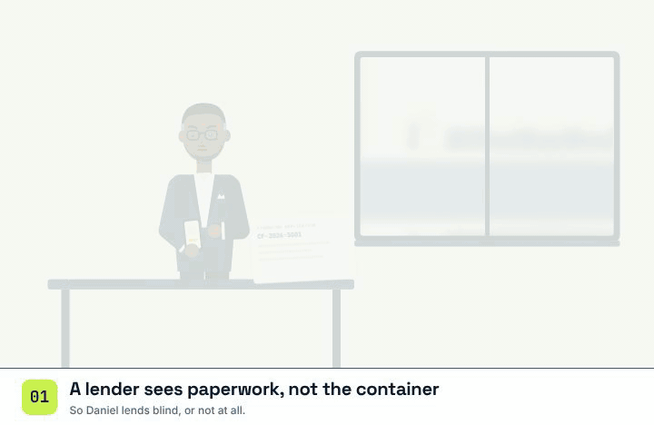</p>

The Asian Development Bank puts the global trade finance gap at
[$2.5 trillion in 2025, about 10% of global trade, with 41% of SME applications rejected](https://www.adb.org/news/demand-trade-finance-rise-amid-supply-chain-realignment-adb-report)
([survey brief](https://www.adb.org/publications/adb-global-trade-finance-gap-survey)). In India, half of B2B sales are
made on credit with
[average payment terms of 52 days](https://group.atradius.com/knowledge-and-research/reports/b2b-payment-practices-trends-india-2025)
(Atradius, 2025), so an exporter waits about two months for cash it has already earned. And the cargo itself is at
risk in transit: biopharma alone loses
[about $35 billion a year to failures in temperature-controlled logistics](https://www.aircargonews.net/pharma-logistics/2019/07/failures-in-temperature-controlled-logistics-cost-biopharma-industry-billions/)
(IQVIA). A lender advancing money against a reefer container sees paperwork, not the container, so it either lends
blind or does not lend. And once it lends, the position is **locked until the buyer pays**: no exit, no price, no way to
recycle the capital. CargoFlow lets the cargo's own sensor evidence decide how much capital is available, and Cargo
Notes let that position be priced and traded while the ship is still at sea.

### The sources, as captured on 3 October 2026

The sentences are highlighted on the original pages, nothing retyped.

<table>
  <tr>
    <td width="50%" valign="top"><a href="https://www.adb.org/news/demand-trade-finance-rise-amid-supply-chain-realignment-adb-report">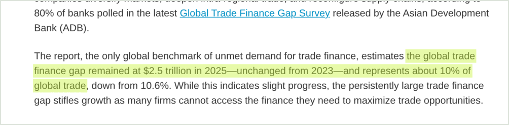</a><br><sub>Asian Development Bank, news release, 15 Jan 2026</sub></td>
    <td width="50%" valign="top"><a href="https://www.adb.org/news/demand-trade-finance-rise-amid-supply-chain-realignment-adb-report">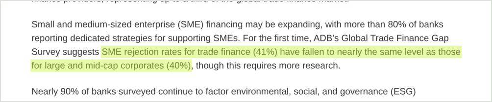</a><br><sub>Same release, citing the ADB Global Trade Finance Gap Survey (Dec 2025)</sub></td>
  </tr>
  <tr>
    <td width="50%" valign="top"><a href="https://group.atradius.com/knowledge-and-research/reports/b2b-payment-practices-trends-india-2025">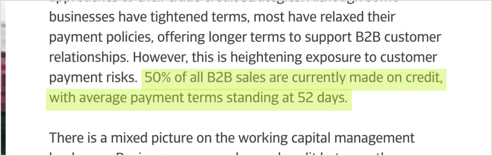</a><br><sub>Atradius, Payment Practices Barometer, India 2025 (PDF p. 3), 29 Jul 2025</sub></td>
    <td width="50%" valign="top"><a href="https://www.aircargonews.net/pharma-logistics/2019/07/failures-in-temperature-controlled-logistics-cost-biopharma-industry-billions/">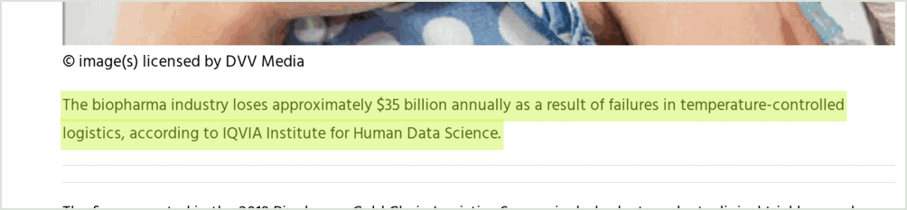</a><br><sub>Air Cargo News, citing the IQVIA Institute, 26 Jul 2019</sub></td>
  </tr>
</table>

## Cargo Notes, the new primitive

<p align="center"><a href="https://cargoflow-monad.vercel.app/notes">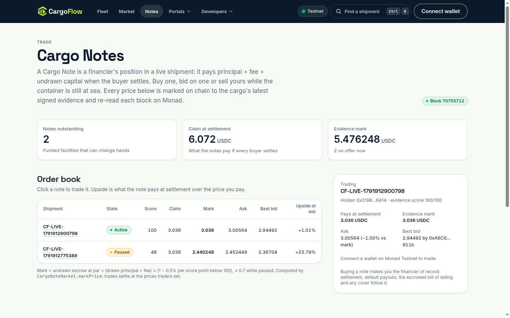</a></p>

A **Cargo Note** is the financier's position in one live facility: the right to principal + fee + undrawn capital when
the buyer settles, the escrowed bill of lading if the facility defaults, and any insurance cover accepted on it.
Before Monad it was locked for the length of the voyage. Now it is an asset:

| | How it works | Where |
|---|---|---|
| **Transferable position** | `transferPosition` moves the financier of record on the controller and the vault atomically; the holder (or one approved operator) may transfer while FINANCED, ACTIVE, PAUSED or DELIVERED, never while disputed or closed, and never to the exporter or the buyer | [`FinancingController.sol`](contracts/src/FinancingController.sol), [`IPositionTransfer.sol`](contracts/src/interfaces/IPositionTransfer.sol) |
| **Order book** | One ask per note and any number of USDC-escrowed bids; `buy` and `acceptBid` pay and transfer in one transaction; stale asks (the note moved) cannot fill; bids can always be withdrawn | [`CargoNoteMarket.sol`](contracts/src/CargoNoteMarket.sol) |
| **Evidence mark, on chain** | `markPrice` = undrawn escrow at par + (drawn principal + fee) × (1 − 0.5% per score point below 100), × 0.7 while paused; DELIVERED marks at par. Read from the vault and `EvidenceRegistry.latestEpochId` | `CargoNoteMarket.markPrice` |
| **Everything follows the note** | Settlement, default refunds, the escrowed title and cover payouts go to the current holder (`CoverPool` reads the holder at payout) | [`CoverPool.sol`](contracts/src/CoverPool.sol) |
| **Fungible notes on Kuru** | `CargoNoteWrapper` wraps a note into a 6-decimal ERC-20 whose supply equals the note's claim, redeemable pro-rata after the facility closes; the token is listed as a spot market on Kuru's order book | [`CargoNoteToken.sol`](contracts/src/CargoNoteToken.sol) |
| **Indexed trade history** | An Envio HyperIndex indexer turns note, order, trade and epoch events into a GraphQL API | [`indexer/`](indexer) |
| **Agent trading** | A MetaMask Agent Wallet plugin lists, quotes, buys, bids on and scans notes within user limits | [`agent-wallet-plugin/`](agent-wallet-plugin) |

**Why it needs Monad.** A note's fair value changes every time its container commits evidence, every few minutes per
shipment, across a whole fleet. Marking, quoting and filling those positions on chain only works if updates are
near-free and final before the next reading arrives. With 400 ms blocks and about 800 ms finality, the `/notes` book
re-reads every block, an excursion moves the mark within a block, and a fill is final before the next sensor sample.
On a slow or expensive chain, the same market collapses back into a spreadsheet.

**Who trades it.** The first financier is an NBFC or trade-finance desk funding Indian pharmaceutical exporters
([USD 30.47 billion in FY 2024-25](https://www.pib.gov.in/PressReleasePage.aspx?PRID=2231234), shipped at 2-8 °C); Cargo
Notes let it recycle capital mid-voyage instead of waiting 52 days. Buyers of notes are credit funds and treasury desks
that want short-dated, self-liquidating USDC yield whose risk they can watch block by block.

## Meet the cast

<p align="center">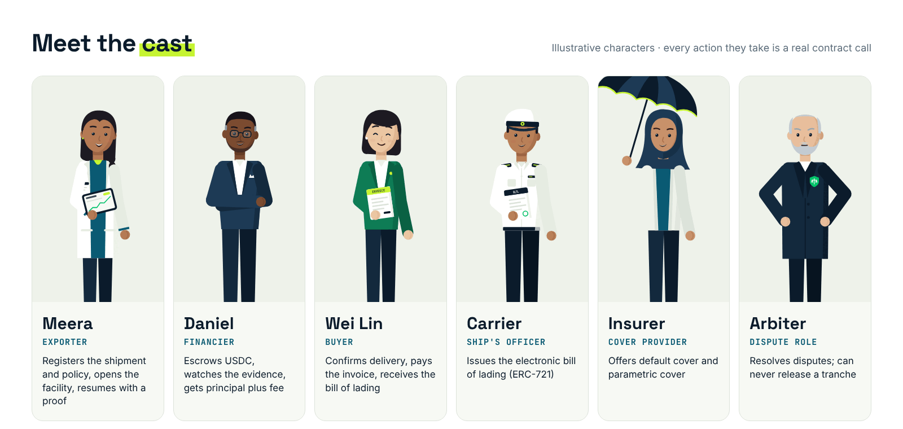</p>

Meera ships vaccines from Pune through Nhava Sheva to Singapore at 2 to 8 °C. Daniel would lend against the shipment
if he could see it, and now he can sell his position before it arrives. Wei Lin buys it. The characters are
illustrative; everything they do below is a real contract call, and each of them has a step-by-step guide:
[exporter](docs/guides/exporter.md) · [financier](docs/guides/financier.md) · [buyer](docs/guides/buyer.md) ·
[carrier](docs/guides/carrier.md) · [arbiter](docs/guides/arbiter.md).

## Why CargoFlow is fundable

| | |
|---|---|
| **Market gap** | A [$2.5 trillion trade finance gap](https://www.adb.org/news/demand-trade-finance-rise-amid-supply-chain-realignment-adb-report) (ADB, 2025), 41% of SME applications rejected, 52-day average terms in India ([Atradius](https://group.atradius.com/knowledge-and-research/reports/b2b-payment-practices-trends-india-2025)). First corridor: India's pharmaceutical exports, [USD 30.47 billion in FY 2024-25](https://www.pib.gov.in/PressReleasePage.aspx?PRID=2231234), shipped at 2 to 8 °C. Bottom-up, with stated assumptions: SAM about $15.2B a year sold on credit (30.47 × 50%), SOM about $152M financed a year at a 1% share by year 3. |
| **Traction** | Eleven contracts source-verified on Monad Testnet; a full lifecycle settled on chain with every transaction linked ([the run](docs/runs/monad-testnet.md)), including a Groth16 recovery and a **Cargo Note sold mid-voyage, then repaid to its new holder**; two live notes with two-sided books on [/notes](https://cargoflow-monad.vercel.app/notes); a public MCP server; 379 contract and 300 frontend unit tests. Pre-revenue. |
| **Moat** | The chain of mechanisms, not one feature: signed device readings, Dempster-Shafer fusion with a published score, a Groth16 recovery proof bound to the contract's own public signals, a vault only the controller can release, a bill of lading that moves inside the payment, and now a position whose price is computed from that evidence on chain. |
| **Business model (planned)** | 30 to 50 bps protocol fee on financed volume inside the settlement waterfall; 10 bps on Cargo Note trades; a share of cover premiums written through the `CoverPool`; data for financiers, insurers and logger vendors. The contracts charge no protocol fee today. |
| **Targets** | $1M in Cargo Notes outstanding within six months of Monad mainnet; a two-sided quote on every live note; at least three notes traded mid-voyage in the first pilot. |
| **Roadmap** | M1 audit and public ZK ceremony · M2 real logger pilots and a secure-element board end to end · M3 **Monad mainnet** with real USDC and the first outside financier · M4 MLETR legal opinion on the bill of lading · M5 calibrated scoring and a second corridor. Each milestone has an exit test. |
| **Use of funds (plan)** | 35% audit and ZK ceremony (M1), 25% pilots and logger hardware (M2), 20% mainnet launch, first facilities and note liquidity (M3), 10% legal (M4), 10% team and infrastructure; released milestone by milestone, the way CargoFlow releases capital. |

## Built on Monad

CargoFlow is submitted to **Monad Metropolis, Track 01: Onchain Finance & Trading**: its core output is a financial
instrument and a market for it, and its first user is a financier. This is what is live today and where to check it.

| Submission evidence | What CargoFlow has | Check it |
|---|---|---|
| **Monad** | Eleven contracts live and source-verified on Monad Testnet (10143); every escrow, tranche, note trade, payment and cover payout is USDC | [Deployed contracts](#deployed-contracts-source-verified) |
| **A new asset primitive** | Cargo Notes: transferable financier positions with an on-chain evidence mark and an order book; an ERC-20 wrapper listed on Kuru | [Cargo Notes](#cargo-notes-the-new-primitive) |
| **Monad features in use** | Sub-second finality for a block-by-block book; the P-256 precompile at `0x100` (verified on chain 10143) for passkey payments through ZeroDev Kernel accounts (EntryPoint v0.7, Kernel v3.1 and the WebAuthn validator are deployed on Monad Testnet); Multicall3 for batched reads | [Under the hood](#under-the-hood) |
| **A working product** | Portals for the exporter, financier, buyer, carrier and arbiter; the note market; a financing market with fee guidance; REST and WebSocket API; remote MCP server for Claude | [Product tour](#product-tour) |
| **Real runs, not mock-ups** | A full lifecycle on the public testnet: excursion, pause, zero-knowledge recovery, a note trade, settlement to the note holder | [Live run](#the-reference-run-cf-live-1791911779438) |
| **Contract quality** | 379 contract tests (unit, fuzz, eight invariants, real-proof integration, 13 for Cargo Notes); immutable core with no proxy; OpenZeppelin 5.4; an authority matrix that lists what each role *cannot* do | [Measured](#measured-not-claimed) · [architecture](docs/architecture.md#who-may-do-what) |

## How it works, in twelve beats

The explainer uses the reference numbers (a 100,000 USDC invoice, a 40,000 USDC facility in five milestones of 8,000,
a 3% fee); the live run uses the same mechanics at testnet scale (a 4 USDC facility against a 7 USDC invoice).

<table>
  <tr>
    <td width="50%" valign="top">
      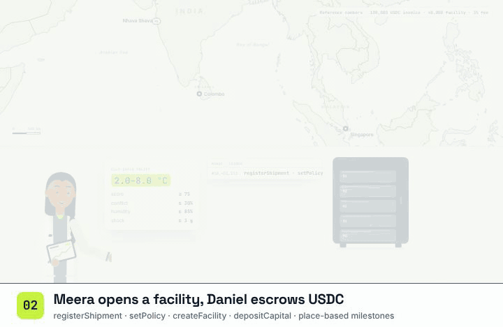
      <p><b>1 · The facility.</b> Meera registers the shipment and reveals a commit-reveal policy (2.0 to 8.0 °C, score ≥ 75, conflict ≤ 30%, humidity ≤ 85%, shock ≤ 3 g). Daniel approves and deposits the whole facility into the <code>ReceivableVault</code>. Milestones can each be tied to a place on the route.</p>
      <sub><code>registerShipment</code> · <code>setPolicy</code> · <code>createFacility</code> · <code>approve</code> + <code>depositCapital</code></sub>
    </td>
    <td width="50%" valign="top">
      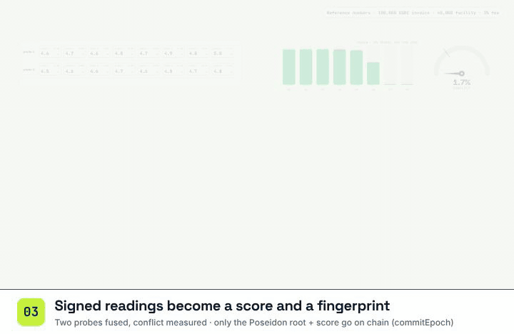
      <p><b>2 · Evidence.</b> The reefer's logger signs each reading with its device key. Eight readings per sensor close an epoch; the two probes are fused (Dempster-Shafer), their disagreement measured, and the epoch scored out of 100. Only a salted Poseidon root and the score go on chain.</p>
      <sub><code>commitEpoch</code> on the <code>EvidenceRegistry</code> (backend worker key)</sub>
    </td>
  </tr>
  <tr>
    <td width="50%" valign="top">
      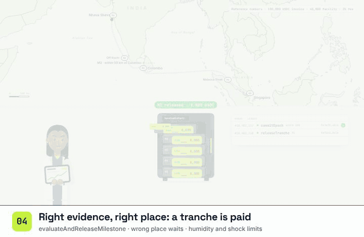
      <p><b>3 · Release.</b> Pass the policy in the right place and a tranche goes to Meera. The controller re-checks the committed epoch against the on-chain policy itself, whatever the backend asked for. Wrong place? It waits: neither a failure nor a pause.</p>
      <sub><code>evaluateAndReleaseMilestone</code> on the <code>FinancingController</code></sub>
    </td>
    <td width="50%" valign="top">
      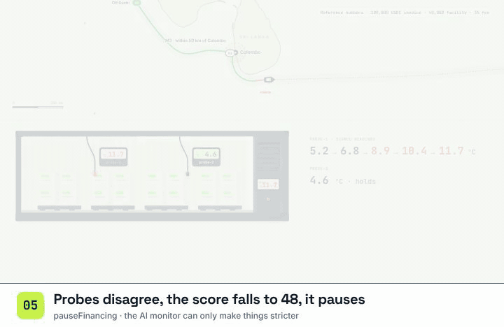
      <p><b>4 · Excursion.</b> Off Sri Lanka probe-1 reaches 11.7 °C, probe-2 holds at 4.6. The sensors disagree (74.8% conflict), the score falls to 48 and the facility pauses: releases now revert. The AI monitor can only make an outcome stricter, through a key that can do nothing but pause.</p>
      <sub><code>pauseFinancing</code> (reason code + AI audit)</sub>
    </td>
  </tr>
  <tr>
    <td width="50%" valign="top">
      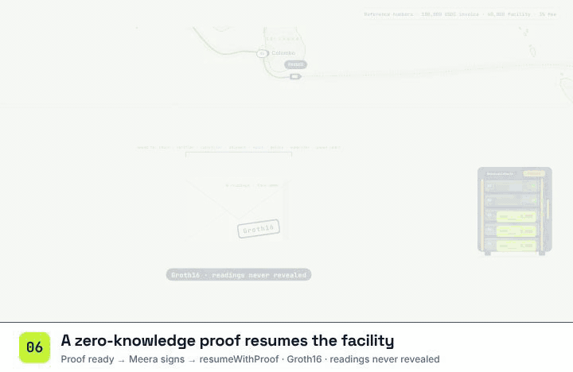
      <p><b>5 · Zero-knowledge recovery.</b> Once probe-2 has eight fresh in-band readings, the service proves in zero knowledge that they sit inside the band, without revealing any of them. Meera signs once; the contract verifies the Groth16 proof, bound to this exact pause, and releases resume.</p>
      <sub><code>resumeWithProof</code> → <code>Groth16Verifier</code></sub>
    </td>
    <td width="50%" valign="top">
      <a href="https://cargoflow-monad.vercel.app/notes"></a>
      <p><b>6 · The note is marked, and trades.</b> Every committed epoch moves the note's on-chain mark (undrawn escrow at par, the drawn leg discounted by the score, 30% off while paused). Daniel allows the market and posts an ask; a trader buys it in one transaction, or Daniel sells into the best escrowed bid. On <a href="https://cargoflow-monad.vercel.app/notes">/notes</a> the book re-reads every block.</p>
      <sub><code>markPrice</code> · <code>setPositionOperator</code> · <code>placeAsk</code> · <code>buy</code> / <code>placeBid</code> · <code>acceptBid</code></sub>
    </td>
  </tr>
  <tr>
    <td width="50%" valign="top">
      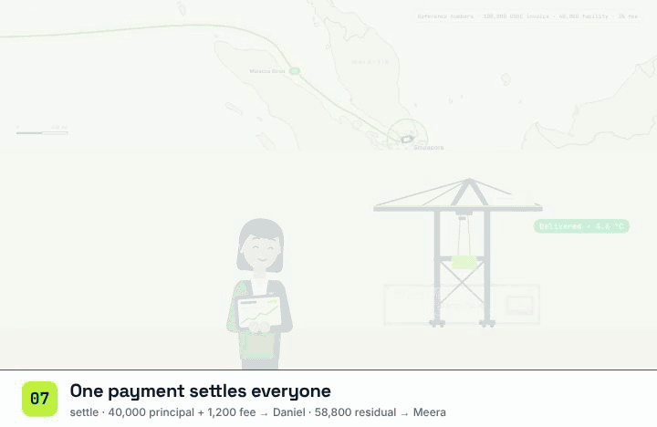
      <p><b>7 · One payment settles the note holder.</b> In Singapore Wei Lin confirms delivery and pays. That one payment runs the waterfall: principal + fee to <b>whoever holds the note</b> (in the live run, the trader who bought it mid-voyage), the residual to Meera.</p>
      <sub><code>markDelivered</code> · <code>approve</code> (vault) + <code>settle</code>, paid out by the <code>ReceivableVault</code></sub>
    </td>
    <td width="50%" valign="top">
      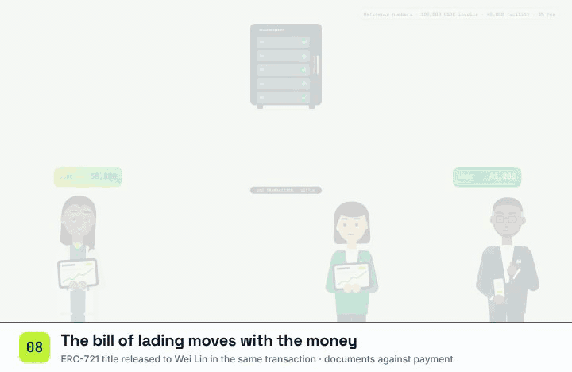
      <p><b>8 · Title moves with the money.</b> The carrier's electronic bill of lading (ERC-721) was bound into escrow; it leaves for Wei Lin in the same transaction as her payment: documents against payment, enforced by the contract. On default it goes to the note holder.</p>
      <sub><code>EBLRegistry</code> · <code>bindTitle</code> · released inside <code>settle</code></sub>
    </td>
  </tr>
  <tr>
    <td width="50%" valign="top">
      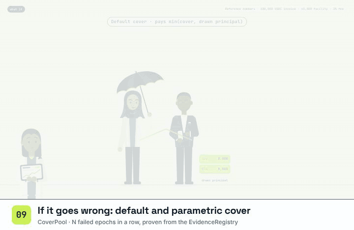
      <p><b>9 · Cover.</b> If it goes wrong, an insurer's default cover pays min(cover, drawn principal). Parametric cover pays after N consecutive failed epochs, proven from the <code>EvidenceRegistry</code>'s commit order. Cover follows the note: it pays the holder at payout.</p>
      <sub><code>CoverPool</code> · pull-based payouts</sub>
    </td>
    <td width="50%" valign="top">
      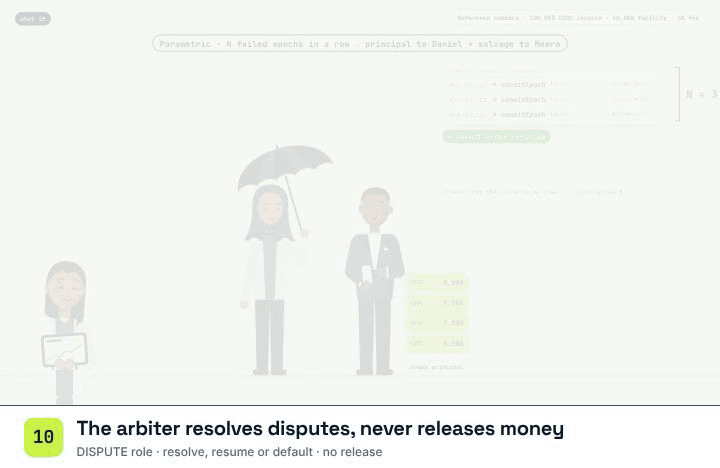
      <p><b>10 · Disputes.</b> The exporter, financier or arbiter can open a dispute, which freezes releases and note transfers. Only the dispute role resolves it (resume or default) and it can never release a tranche.</p>
      <sub><code>openDispute</code> · <code>resolveDispute</code> · <code>markDefaulted</code></sub>
    </td>
  </tr>
  <tr>
    <td width="50%" valign="top">
      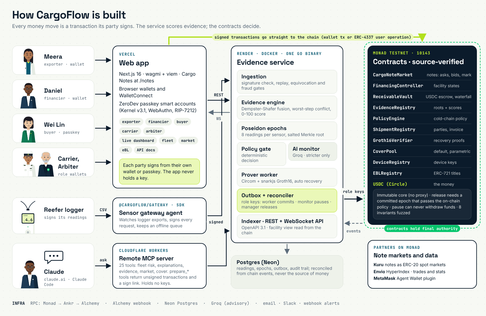
      <p><b>11 · Agents and markets.</b> An Envio HyperIndex indexer serves the note book's history; a MetaMask Agent Wallet plugin lets an agent list, quote, buy, bid on and scan notes within limits; Claude reads everything through the remote MCP server and prepares unsigned transactions.</p>
      <sub><code>indexer/</code> · <code>agent-wallet-plugin/</code> · <code>packages/mcp</code></sub>
    </td>
    <td width="50%" valign="top">
      <a href="https://cargoflow-monad.vercel.app">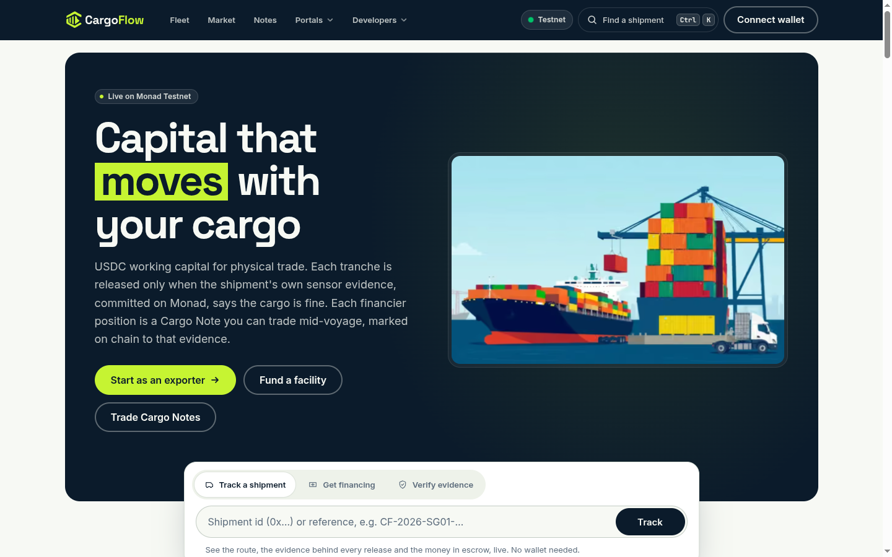</a>
      <p><b>12 · All of it, on chain.</b> Every beat above ran on Monad Testnet in one shipment: 22 transactions, from registration to the note trade to settlement paid to the note's new holder. <a href="docs/runs/monad-testnet.md">Transactions</a>.</p>
      <sub><a href="https://cargoflow-monad.vercel.app/track/0x0353f55d82eb48314a58c34eab518cfe88999aaf6885e9cc41c9d10a042ac58e">Open the settled shipment</a></sub>
    </td>
  </tr>
</table>

### The same story as a sequence diagram

A 40,000 USDC facility against a 100,000 USDC invoice, 5 milestones of 8,000, 3% fee, and a note sold mid-voyage.

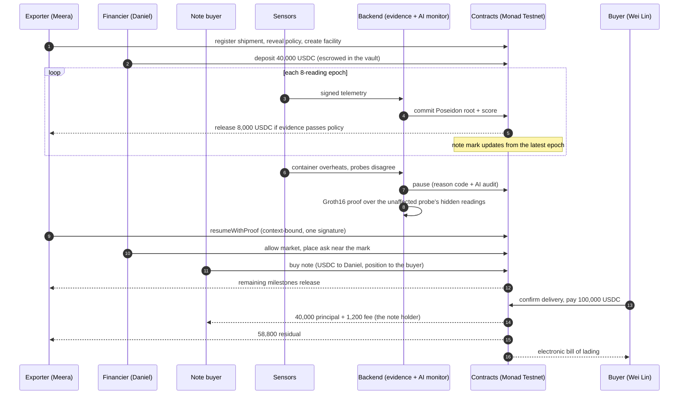

What makes it different:

- **Capital follows physical evidence.** A failed milestone changes what can be drawn, on chain, not in a dashboard.
- **A position with a price.** The note's mark is computed by the contract from the evidence, so risk is priced in the
  same block the cargo reports it.
- **No single oracle.** Sources are fused with Dempster-Shafer and an explicit conflict factor, then scored with
  documented penalties. The same input always yields the same score.
- **Privacy by construction.** Raw telemetry never goes on chain: only Poseidon Merkle roots, scores and proof
  verification status do. Recovery is proved in zero knowledge over readings that stay private.
- **An AI that cannot move money.** A language model may only make an outcome *stricter*, through a key that holds no
  other role. See [the AI monitor](backend/README.md#ai-monitor).
- **Contracts hold final authority.** Core contracts are immutable (no proxy). Pause is narrow and cannot withdraw
  funds. Eight invariants are fuzz- and invariant-tested.

## Product tour

Every frame below is the live app at **https://cargoflow-monad.vercel.app** on Monad Testnet.

<p align="center"><a href="https://cargoflow-monad.vercel.app"></a></p>

| Page | What you do there |
|---|---|
| [`/notes`](https://cargoflow-monad.vercel.app/notes) | **Trade Cargo Notes:** the book with score, claim, mark, ask, best bid and upside; holders allow the market and place asks or sell into bids; anyone approves USDC and buys or bids |
| [`/exporter`](https://cargoflow-monad.vercel.app/exporter) | Four steps (shipment, cold-chain policy, financing, sign); the Pharma template fills 2 to 8 °C, humidity and shock |
| [`/financier`](https://cargoflow-monad.vercel.app/financier) | Facilities that name your wallet, a settlement preview, approve and deposit |
| [`/buyer`](https://cargoflow-monad.vercel.app/buyer) | Confirm delivery and pay the invoice |
| [`/ebl`](https://cargoflow-monad.vercel.app/ebl) | The carrier issues bills of lading; the exporter binds one to the facility |
| [`/market`](https://cargoflow-monad.vercel.app/market) | Financing requests without a financier, offers and a suggested fee band |
| [`/arbiter`](https://cargoflow-monad.vercel.app/arbiter) | Dispute resolution for the dispute-role wallet |
| `/track/{id}` | The live shipment: route, milestones, evidence per epoch, escrow, AI monitor, zero-knowledge recovery, title, audit trail with MonadVision links |

## Use CargoFlow in Claude

CargoFlow runs a public remote MCP server, so Claude can read shipments, evidence, cover and the market, and prepare
unsigned transactions (with `chainId` 10143) and a link to sign them in the web app. It holds no keys.

```bash
claude mcp add --transport http cargoflow https://cargoflow-monad-mcp.adoranto737.workers.dev/mcp   # Claude Code
```

In claude.ai: Settings → Connectors → [Add custom connector](https://claude.ai/new?modal=add-custom-connector), name it
CargoFlow and paste the URL. 25 tools: shipments, evidence, explanations, track, audit, parties, market, cover,
documents, fleet risk, pricing, EPCIS, bills of lading, and `prepare_*` tools for deposit, release, ZK resume,
delivery, settlement, dispute, cover, cancel and parametric trigger. Ask: *"Using CargoFlow, summarise the fleet risk
and explain any paused shipment."* Source: [`packages/mcp`](packages/mcp).

## Architecture

<p align="center"></p>

The chain is the financial source of truth. Each party signs its own money moves from the web app, straight to the
contracts. The Go service scores evidence and acts on chain only through three role-limited keys: the worker commits
epochs, the monitor may only pause, the manager starts transit, releases and submits proofs. Postgres holds
operational evidence and is reconciled from chain events; the API's facility view reads the chain directly, so a
lagging indexer can never show money that did not move. The note market holds no role at all: it moves a position
only as the holder's approved operator.

| Trust boundary | What crosses | Protection |
|---|---|---|
| Sensor → service | readings | Ed25519 (or P-256 / passkey) signature over method, path, time and body hash; replay, equivocation and fraud gates |
| Service → chain | roots, scores, pauses, releases | three role-limited keys, idempotent outbox, startup role verification |
| Service → model | integers, booleans, enum members | no telemetry-derived text; strict parsing; any failure falls back to the policy gate |
| Model → chain | at most a pause request | stricter-only, confidence threshold, pause-only key; contracts decide legality |
| Prover → chain | `a, b, c` | the contract derives every public signal; the proof is bound to chain, verifier, controller, shipment, epoch, policy, submitter and pause count |
| Market → position | a transfer | only the holder or its one-shot operator; never while disputed or closed; never to the exporter or buyer |
| MCP / Claude / agents → anything | reads and unsigned transactions | hold no keys; every write is signed by the party in their own wallet |

Components, the facility state machine and the full authority matrix are in [`docs/architecture.md`](docs/architecture.md).

### Repository layout

| Path | Purpose |
|---|---|
| `contracts/` | Solidity core (Foundry): registry, policy, evidence, controller, vault, verifier, cover, devices, bills of lading, **note market and note token** |
| `backend/` | Go service: ingestion, evidence engine, AI monitor, proof worker, API, indexer (100-block `eth_getLogs` windows for Monad), reconciler |
| `circuits/` | Circom telemetry-epoch circuit and Groth16 tooling |
| `frontend/` | Next.js 16 web app: landing, live dashboard, fleet, **Cargo Notes**, market, portals, bills of lading, passkey accounts, API reference |
| `indexer/` | **Envio HyperIndex** indexer for notes, trades, orders, epochs and market stats |
| `agent-wallet-plugin/` | **MetaMask Agent Wallet** plugin: `mm cargo list \| quote \| buy \| bid \| scan` |
| `packages/sdk` · `packages/mcp` · `packages/gateway` · `packages/python` | TypeScript client, MCP server, data-logger edge agent, Python analytics |
| `infra/` · `scripts/` | Dockerfile and compose; Monad deploy, funding and Sourcify verification |
| `docs/` | Architecture, role guides, runbooks, security, live runs, submission kit |

## Live on Monad Testnet

Chain `10143` · RPC `https://testnet-rpc.monad.xyz` · Explorer `https://testnet.monadvision.com`

**Use it now:** connect any wallet on Monad Testnet. MON from [faucet.monad.xyz](https://faucet.monad.xyz), USDC from
[faucet.circle.com](https://faucet.circle.com) (choose Monad Testnet).

| Service | URL |
|---|---|
| Web app (Vercel) | **https://cargoflow-monad.vercel.app** |
| API (Render, Docker) | https://cargoflow-monad-api.onrender.com ([health](https://cargoflow-monad-api.onrender.com/v1/health), [OpenAPI 3.1](https://cargoflow-monad-api.onrender.com/v1/openapi.json)) |
| Interactive API reference | https://cargoflow-monad.vercel.app/docs |
| Remote MCP server (Cloudflare Workers) | `https://cargoflow-monad-mcp.adoranto737.workers.dev/mcp` |
| Every contract and service | https://cargoflow-monad.vercel.app/deployments |

The free Render instance sleeps when idle, so the first request after a quiet spell can take up to a minute.

### Deployed contracts (source-verified)

Every contract's source is verified on MonadVision through Sourcify. Manifest:
[`contracts/deployments/monad-testnet.json`](contracts/deployments/monad-testnet.json).

| Contract | What it does | Address |
|---|---|---|
| **CargoNoteMarket** | Cargo Note order book: asks, escrowed bids, atomic fills, on-chain evidence mark | [`0x120142b2e5A90F2676F41d8d20bDCC94C66ec55d`](https://testnet.monadvision.com/address/0x120142b2e5A90F2676F41d8d20bDCC94C66ec55d) |
| FinancingController | Facility state machine, place-based milestones, pause, ZK resume, title binding, cancel, **position transfer** | [`0x172f8B86a9368ef729fa76c773ECA03d166DEB4d`](https://testnet.monadvision.com/address/0x172f8B86a9368ef729fa76c773ECA03d166DEB4d) |
| ReceivableVault | Escrow and the settlement waterfall | [`0x5298dCdBDf6EC799475B09c2Ecd0f089bD4D6902`](https://testnet.monadvision.com/address/0x5298dCdBDf6EC799475B09c2Ecd0f089bD4D6902) |
| EvidenceRegistry | Committed epochs: Poseidon root, score, centroid, maxima, source devices, latest epoch | [`0x4aD47799586B4793b7952BA849013F5D0eC2e66a`](https://testnet.monadvision.com/address/0x4aD47799586B4793b7952BA849013F5D0eC2e66a) |
| ShipmentRegistry | Shipments, parties, invoice hash, route commitment | [`0x2f7cAc603654eC106dA242cD0b16044b31f7608d`](https://testnet.monadvision.com/address/0x2f7cAc603654eC106dA242cD0b16044b31f7608d) |
| PolicyEngine | Commit-reveal cold-chain policy | [`0x93f2cd67f404f62Ff34F729aad1118ea9e1582d0`](https://testnet.monadvision.com/address/0x93f2cd67f404f62Ff34F729aad1118ea9e1582d0) |
| Groth16Verifier | On-chain verification of the recovery proof | [`0x1BAa24a99A9Fe8Cd53feB30E5dF098D1334E0a8D`](https://testnet.monadvision.com/address/0x1BAa24a99A9Fe8Cd53feB30E5dF098D1334E0a8D) |
| CoverPool | Default and parametric cover; pays the note holder | [`0x8E8e19744C9066320509b5c9acD50AC092837083`](https://testnet.monadvision.com/address/0x8E8e19744C9066320509b5c9acD50AC092837083) |
| EBLRegistry | Electronic bills of lading as ERC-721 titles | [`0xA2E708376CDDf0eb8fa746c43089611B4d49E210`](https://testnet.monadvision.com/address/0xA2E708376CDDf0eb8fa746c43089611B4d49E210) |
| DeviceRegistry | Evidence devices and their class | [`0x88188585DF01F73C5f6c9c646651Bc0b3fb622d9`](https://testnet.monadvision.com/address/0x88188585DF01F73C5f6c9c646651Bc0b3fb622d9) |
| CargoFlowAccess | Roles (OpenZeppelin `AccessControlDefaultAdminRules`) | [`0x5Ed4f105E3c3C0a67f916c0fc339B261E3De81d7`](https://testnet.monadvision.com/address/0x5Ed4f105E3c3C0a67f916c0fc339B261E3De81d7) |
| USDC | Circle testnet stablecoin, 6 decimals | [`0x534b2f3A21130d7a60830c2Df862319e593943A3`](https://testnet.monadvision.com/address/0x534b2f3A21130d7a60830c2Df862319e593943A3) |
| **CargoNoteWrapper** | Wraps a note into a `CargoNoteToken` (the token becomes the financier of record) | [`0xD176E4e02f97F12462e68014F92B2A13A664552e`](https://testnet.monadvision.com/address/0xD176E4e02f97F12462e68014F92B2A13A664552e) |
| **cNOTE-0516** (`CargoNoteToken`) | Note `CF-LIVE-1791917840516` as a 6-decimal ERC-20, supply 3.036 = its claim | [`0x427c9617808445509e2E1877655251A5CE4c6D1e`](https://testnet.monadvision.com/address/0x427c9617808445509e2E1877655251A5CE4c6D1e) |
| **Kuru market cNOTE-0516/USDC** | Created through Kuru's permissionless Router; limit sell 3 @ 0.99, market-buy filled ([transactions](docs/runs/monad-testnet.md#cargo-notes-on-kuru-cf-live-1791917840516)) | [`0x13f02ef0c5CF7357267C52947709acfE52021520`](https://testnet.monadvision.com/address/0x13f02ef0c5CF7357267C52947709acfE52021520) |

Passkey accounts use ZeroDev Kernel already deployed on Monad Testnet (EntryPoint v0.7
`0x0000000071727De22E5E9d8BAf0edAc6f37da032`, Kernel v3.1 factory `0xd703aaE79538628d27099B8c4f621bE4CCd142d5`,
WebAuthn validator `0x7ab16Ff354AcB328452F1D445b3Ddee9a91e9e69`) and the P-256 precompile at `0x100`.

### The reference run: `CF-LIVE-1791911779438`

On 13 October 2026 one shipment ran end to end on Monad Testnet, every party signing from its own wallet: register,
policy, facility (5 × 0.8 USDC against a 7 USDC invoice), deposit, transit, two evidence-gated releases, the reefer
failing (score 48), an automatic pause, a Groth16 recovery verified on chain, **a Cargo Note sold 1% under its
evidence mark**, the remaining releases, delivery and settlement **paid to the note's new holder**
([dashboard](https://cargoflow-monad.vercel.app/track/0x0353f55d82eb48314a58c34eab518cfe88999aaf6885e9cc41c9d10a042ac58e)).
All 22 transactions are in [`docs/runs/monad-testnet.md`](docs/runs/monad-testnet.md); the highlights:

| Who | Step | Transaction |
|---|---|---|
| Exporter | Registers the shipment · reveals the policy · opens the facility | [`0x89160901…`](https://testnet.monadvision.com/tx/0x8916090141214f8f29e91772e607758fc3a241ebad71b2b7cf6ede8a9c0e2586) · [`0xd7f300b2…`](https://testnet.monadvision.com/tx/0xd7f300b255aed3193a59fdd9f796c87acbe1a4b84728a4828c4887c3fc479df0) · [`0x3b92b06b…`](https://testnet.monadvision.com/tx/0x3b92b06bab456c53112c003a55c848724d745537e8802164ba41e38234436407) |
| Financier | Deposits 4 USDC | [`0x3e9c417b…`](https://testnet.monadvision.com/tx/0x3e9c417bbe7fc30b33018ebc203d4f677ee233e8d23bdb69d653585a94c9fa39) |
| Backend | Milestones 1 and 2 released (score 100) | [`0x47046b26…`](https://testnet.monadvision.com/tx/0x47046b2617bbc23b86b24164d32dc793787928a2c8c31e3e994e778da748ebda) · [`0xb9b6d736…`](https://testnet.monadvision.com/tx/0xb9b6d736adf0e4aac7b911e69ea6a468972abf8e5de0ea7023f081dbbacd10e4) |
| Backend | Excursion: epoch scores 48, facility paused | [`0x6618c4cf…`](https://testnet.monadvision.com/tx/0x6618c4cf7fd93c2cb25ffa24aeadb6126922e6a1a409cb4a74ec7b0e8c73ec07) · [`0xeb5a604e…`](https://testnet.monadvision.com/tx/0xeb5a604eb03db63c60be63b7806adba0fc1fbef752e22733fbba699e98a415a6) |
| Exporter | Resumes with a Groth16 proof; milestone 3 released | [`0x0c2afd1c…`](https://testnet.monadvision.com/tx/0x0c2afd1ccafcd8ff7ea120c5ed9b9114e4dcdf963dc76f613a755312388b3e62) · [`0x252656b1…`](https://testnet.monadvision.com/tx/0x252656b11a0b6d8c1fff36bf29880745162d3d8b7c9d43149a1aa58d83856676) |
| Financier | **Allows the market, asks 4.006807 USDC** (mark 4.04728, claim 4.072) | [`0xb4a3bd09…`](https://testnet.monadvision.com/tx/0xb4a3bd09962a5bd3b07d5a499d9da50279f37aacb1fa89df7f00c7c9de5af659) · [`0xaf11f532…`](https://testnet.monadvision.com/tx/0xaf11f532e73d82983fcc87db3eef622a567766b3cc7d157658121cdb7540b082) |
| Trader | **Buys the note**: now the financier of record | [`0x8525c279…`](https://testnet.monadvision.com/tx/0x8525c279e19eec78ffffaf4f4bb62efa7f7169ba7a25f4d8032b91b10596a187) |
| Buyer | Confirms delivery · pays; **4.12 USDC to the note holder**, 2.88 residual to the exporter | [`0xd5d454b9…`](https://testnet.monadvision.com/tx/0xd5d454b901ef4c87335a1fe5b69d3c65d68603cf50a6f253934e48fe6ef0ce21) · [`0xbd203765…`](https://testnet.monadvision.com/tx/0xbd203765ca9e55d24689bf7941f33f4f293f6e92750d75f19eb1037c61458c27) |

### Live notes on the book

Two facilities are left mid-voyage so judges can trade them on [/notes](https://cargoflow-monad.vercel.app/notes):

| Note | State | Evidence score | Book |
|---|---|---|---|
| `CF-LIVE-1791912900798` (`0xb508ee58…39ff`) | ACTIVE | 100 | an ask just under the mark and an escrowed bid |
| `CF-LIVE-1791912775389` (`0xe2785515…e7dc`) | PAUSED after a reefer failure | 48 | mark carries the 30% paused haircut; ask and bid around it |

The run is reproducible: `NOTE_TRADE=1 FACILITY_USDC=4 INVOICE_USDC=7 npx tsx frontend/scripts/testnet-lifecycle.ts <api url>`
(`STOP=active` leaves a facility mid-voyage with a two-sided book).

## Under the hood

### Evidence engine

Readings are validated and aligned into time buckets; each sensor contributes a mass over {physically fine, violated,
unknown}, and Dempster-Shafer combines them per bucket while recording the worst conflict between sources. Seven
capped penalties (physical, conflict, freshness, route, source reliability, fraud, coverage) turn that into a 0-100
score with a published formula. Eight readings close an epoch whose salted Poseidon Merkle root is committed on chain
with the score, conflict and risk; the readings stay in Postgres. The controller releases only if the committed epoch
satisfies the on-chain policy, whatever the backend asked for.
Details: [the evidence score](backend/README.md#the-evidence-score), [`docs/project/07-evidence-engine.md`](docs/project/07-evidence-engine.md).

### Zero-knowledge recovery

After a pause, a Groth16 proof shows that eight readings of the unaffected probe, committed after the pause, lie
inside the policy band, without revealing any of them. The contract derives every public signal itself, and the proof
is bound to the chain, verifier, controller, shipment, epoch, policy, submitter and pause count. The circuit has 13,494
constraints and proves in about a second; on Monad the run above verified it in transaction
[`0x0c2afd1c…`](https://testnet.monadvision.com/tx/0x0c2afd1ccafcd8ff7ea120c5ed9b9114e4dcdf963dc76f613a755312388b3e62).
Details: [automatic ZK recovery](backend/README.md#automatic-zk-recovery), [`docs/project/08-zk-and-privacy.md`](docs/project/08-zk-and-privacy.md).

### Cargo Notes

The controller's `transferPosition` updates the financier on itself and on the vault in one call; `CoverPool` pays the
holder at claim or trigger time, so cover travels with the note. `CargoNoteMarket` keeps one ask per note and a bid per
bidder (escrowed; re-bidding refunds the difference), checks on every fill that the ask's seller still holds the note,
and computes `markPrice` from the vault (`committed`, `drawn`, `feeBps`) and the score of
`EvidenceRegistry.latestEpochId`. 13 Foundry tests cover marks, fills, stale asks, bids, transfer rules and a
settlement paid to the new holder ([`CargoNoteMarket.t.sol`](contracts/test/core/CargoNoteMarket.t.sol)); the frontend
mirrors the mark formula in [`lib/notes.ts`](frontend/src/lib/notes.ts) with unit tests.

### AI monitor

A language model (Groq, OpenAI-compatible API) reviews every evaluated epoch and returns a strictly parsed,
schema-checked assessment. It is advisory: it may only ask for a stricter outcome, only above a confidence threshold,
and pause is its only possible on-chain effect, through a monitor key that holds no other role.
Details: [the AI monitor](backend/README.md#ai-monitor).

### Disputes, title, devices, cover

- **Disputes and defaults.** A dispute freezes releases and note transfers; only the dispute role resolves it, and it can
  never release a tranche. On default the vault returns undrawn USDC to the note holder.
- **Electronic bill of lading.** One ERC-721 token per bill; bound to a facility, it moves under documents against
  payment: to the buyer inside the payment, to the note holder on default, back to the exporter on cancel.
- **Device trust.** Gateways sign with Ed25519, P-256 keys in secure elements or WebAuthn passkeys; every epoch records
  on chain which devices fed it.
- **Parametric cover.** Pays after N consecutive failed epochs, proven from the `EvidenceRegistry`'s commit order.

### Monad-specific engineering

- **Indexer windows.** Monad's public RPC caps `eth_getLogs` at 100 blocks; the backend indexer reads in 100-block
  windows (`INDEXER_MAX_RANGE`) from the deployment block.
- **Batched reads.** The web app routes reads through Multicall3 (`0xcA11…CA11`) with a fallback RPC, so the note book
  can refresh every couple of seconds without rate limits.
- **Gas.** Monad charges the gas limit; the deploy script pins 102 gwei (base 100 + 2 tip) and the full deployment cost
  about 2 MON.
- **Restart safety.** Rebuilding a shipment's evidence pipeline after a recovery epoch (which re-commits earlier
  readings) de-duplicates and time-orders the history.

## For developers

### Try it locally

Needs Foundry, Go 1.26, Node 20+, Docker (for Postgres) and [circom](https://docs.circom.io/getting-started/installation/).

```bash
git clone --recursive https://github.com/LSUDOKO/CargoFlow-Monad && cd CargoFlow-Monad
cp .env.example .env                                  # Monad RPC, USDC address, role keys
make contracts-test                                   # 379 Foundry tests
docker run -d -p 5434:5432 -e POSTGRES_USER=cargoflow -e POSTGRES_PASSWORD=cargoflow-local-only -e POSTGRES_DB=cargoflow postgres:17
make migrate && make serve                            # API + indexer + evidence pipeline against Monad Testnet
cd frontend && pnpm install && pnpm dev               # http://localhost:3000
NOTE_TRADE=1 FACILITY_USDC=4 INVOICE_USDC=7 npx tsx scripts/testnet-lifecycle.ts http://127.0.0.1:8090
```

Deploy your own: `BROADCAST=1 ./scripts/deploy-testnet.sh` (about 2 MON), `./scripts/testnet-fund.sh`,
`./scripts/verify-testnet.sh` (Sourcify on MonadVision).

### Developer platform

| Piece | What it gives you |
|---|---|
| [API reference](https://cargoflow-monad.vercel.app/docs) | OpenAPI 3.1 generated from the Go route table, with every wallet-signed message format |
| SDK · [source](packages/sdk) | Typed client for every endpoint, ABIs, `prepare*` transaction builders for any wallet, gateway signing, Merkle proof checks; defaults to Monad Testnet |
| MCP server · [source](packages/mcp) | The remote server above, also runnable locally over stdio |
| Gateway agent · [source](packages/gateway) | Signs and sends logger exports with an offline queue; USB and serial modes |
| Python · [source](packages/python) | Data frames, portfolio exposure, excursion statistics, a Monte Carlo of default and recovery |
| Envio indexer · [source](indexer) | GraphQL over notes, trades, orders, epochs and market stats (HyperSync `https://10143.hypersync.xyz`) |
| Agent Wallet plugin · [source](agent-wallet-plugin) | `mm cargo list`, `quote`, `buy`, `bid`, `scan` |

The npm and PyPI releases of these packages were published from the original CargoFlow repository; the Monad sources
are in this repository.

### Deployment

| Piece | Where | How |
|---|---|---|
| Web app | Vercel | `cd frontend && vercel deploy --prod` (`NEXT_PUBLIC_API_URL` is compiled into the bundle) |
| API, indexer, evidence pipeline, prover | Render (Docker, Singapore) | [`infra/docker/backend.Dockerfile`](infra/docker/backend.Dockerfile): the Go binary plus the compiled circuit and snarkjs prover |
| Database | Neon Postgres (Singapore) | migrations run on start |
| Contracts | Monad Testnet | `BROADCAST=1 ./scripts/deploy-testnet.sh`, then `./scripts/verify-testnet.sh` |
| Remote MCP server | Cloudflare Workers | `cd packages/mcp && npx wrangler deploy` |

## Sponsor and partner integrations

<p align="center">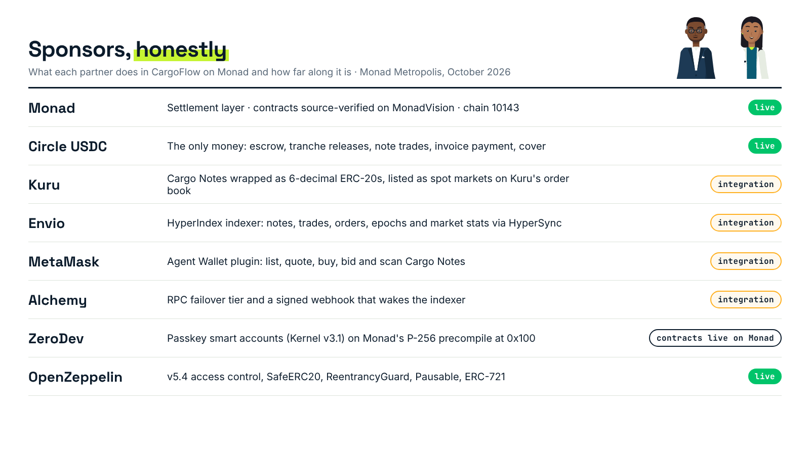</p>

| Partner | How CargoFlow uses it | Status | Where |
|---|---|---|---|
| **Monad** | All contracts, settlement, note trades and evidence commitments on Monad Testnet (10143); sub-second finality drives the block-by-block note book | live | [`contracts/`](contracts) |
| **Circle USDC** | Escrow, tranche releases, note trades, invoice payment and cover are real testnet USDC | live | `0x534b…43A3` |
| **Kuru** | `CargoNoteWrapper` turns a Cargo Note into a 6-decimal ERC-20 whose supply equals the note's claim, redeemable pro-rata after the facility closes; the token is listed as a spot market against USDC through Kuru's permissionless Router (`0x7EFbE105Ca7415dE98F96622173458ac1c054630`), giving notes a central limit order book. **Live:** cNOTE-0516/USDC market [`0x13f02ef0…`](https://testnet.monadvision.com/address/0x13f02ef0c5CF7357267C52947709acfE52021520) with a filled trade | live | [`contracts/src/CargoNoteToken.sol`](contracts/src/CargoNoteToken.sol) <!-- INTEGRATION: kuru --> |
| **Envio** | HyperIndex indexer over `CargoNoteMarket`, `FinancingController` and `EvidenceRegistry` on HyperSync (`https://10143.hypersync.xyz`): `Note`, `Trade`, `OrderEvent`, `Epoch` and `MarketStats` entities. **Live on Envio Cloud** ([GraphQL](https://indexer.dev.hyperindex.xyz/bc5a6d2/v1/graphql)), synced to the chain head; it powers the **Market activity** feed and the trade/volume counters on [/notes](https://cargoflow-monad.vercel.app/notes) | live | [`indexer/`](indexer) <!-- INTEGRATION: envio --> |
| **MetaMask Agent Wallet** | A plugin that gives the agent wallet a Cargo Notes superpower: `mm cargo list \| quote \| buy \| bid \| scan`, priced from the on-chain evidence mark and bounded by user limits (min score, max price, max premium to mark, budget). **Live:** the agent wallet bought note `CF-LIVE-1791912900798` on Monad Testnet after email 2FA ([transactions](docs/runs/monad-testnet.md#an-ai-agent-buys-a-cargo-note-metamask-agent-wallet--the-cargo-notes-plugin)) | live | [`agent-wallet-plugin/`](agent-wallet-plugin) <!-- INTEGRATION: metamask --> |
| **Alchemy** | **Primary RPC of the hosted API on Monad Testnet** (`monad-testnet.g.alchemy.com`): every chain read, indexer `eth_getLogs` window (10 blocks, the free-tier limit) and role-key transaction, with Monad's public RPC as the automatic fallback; plus a signed Notify webhook endpoint that wakes the indexer (the payload is never trusted; logs are re-read from the chain) | live | [`backend/internal/api/webhooks.go`](backend/internal/api/webhooks.go), [`backend/cmd/alchemy-webhook`](backend/cmd/alchemy-webhook) <!-- INTEGRATION: alchemy --> |
| **ZeroDev** | Passkey smart accounts (Kernel v3.1, WebAuthn validator) on Monad's P-256 precompile; the account contracts are deployed on Monad Testnet | contracts live on Monad | [`frontend/src/lib/passkey`](frontend/src/lib/passkey) |
| **OpenZeppelin** | v5.4: `AccessControlDefaultAdminRules`, `SafeERC20`, `ReentrancyGuard`, `Pausable`, `ERC721`, `Math` | live | [dependency matrix](docs/architecture.md#openzeppelin-dependency-matrix-v540-vendored) |
| **MonadVision · Sourcify** | Source verification of every deployed contract | live | [`scripts/verify-testnet.sh`](scripts/verify-testnet.sh) |

### Sponsor proof, in screenshots

Every card below is real output from Monad Testnet on 14 October 2026; each transaction is linked in
[`docs/runs/monad-testnet.md`](docs/runs/monad-testnet.md). The terminal cards are rendered from the captured
command output ([`video/proofs/`](video/proofs)); the two app captures are the live site.

**The live app:** the note order book, marked on chain to each cargo's evidence (one note paused at score 48 with its mark haircut).

<p align="center"><a href="https://cargoflow-monad.vercel.app/notes">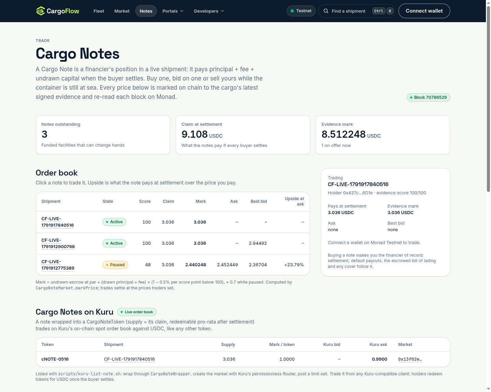</a></p>

**MetaMask Agent Wallet:** the `cargo-notes` plugin refuses a paused note without signing, then buys an active one;
each transaction waited for the owner's email approval (2FA). Approve [0x10c17841…](https://testnet.monadvision.com/tx/0x10c178413612c177dffba0e71e12ca3cb8941c53b61b515de30504c80060519c) ·
buy [0x55a0bf98…](https://testnet.monadvision.com/tx/0x55a0bf9840c9d028848cd0136e8a8cf0218c96aee1732b4cd0554f01e2ae357c).

<p align="center">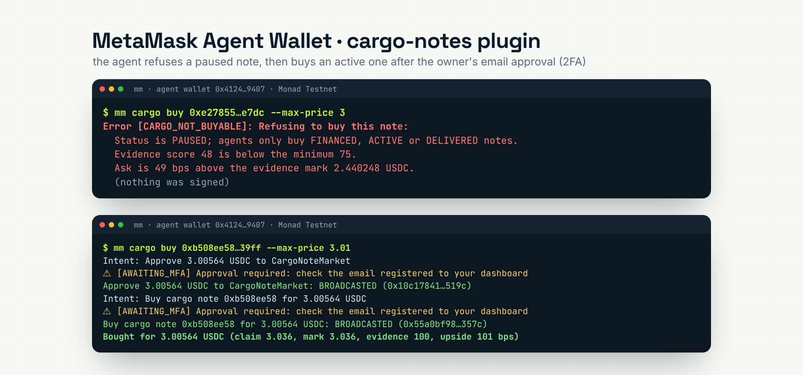</p>

**Kuru:** a note wrapped into `cNOTE-0516` and listed on Kuru's spot order book through its permissionless Router; a limit sell at
0.99 USDC and a market buy filled. Wrap [0xf130430c…](https://testnet.monadvision.com/tx/0xf130430ceadd960f220de6267dfb9fe8af68a11df3de2e2221a089c4b6f82e1c) ·
market [0x13f02ef0…](https://testnet.monadvision.com/address/0x13f02ef0c5CF7357267C52947709acfE52021520) ·
fill [0xade132a7…](https://testnet.monadvision.com/tx/0xade132a7524680c7e3b9270923ccbb61be845c026173d5e1f0cd13753bf4c01b).

<p align="center">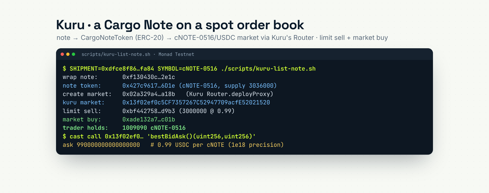</p>

**Envio:** the HyperIndex indexer on Envio Cloud, synced to the chain head ([GraphQL](https://indexer.dev.hyperindex.xyz/bc5a6d2/v1/graphql)), and the
**Market activity** feed it powers on the live site (both trades, including the agent's buy from `0x4124…9407`).

<p align="center">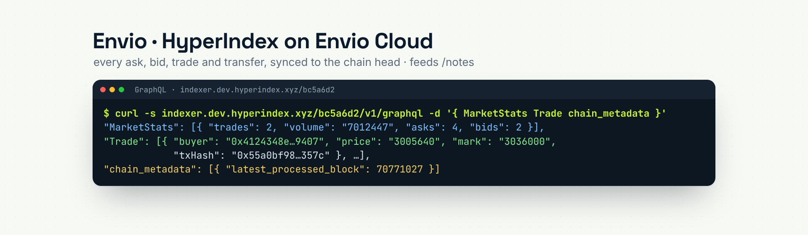</p>

<p align="center"><a href="https://cargoflow-monad.vercel.app/notes">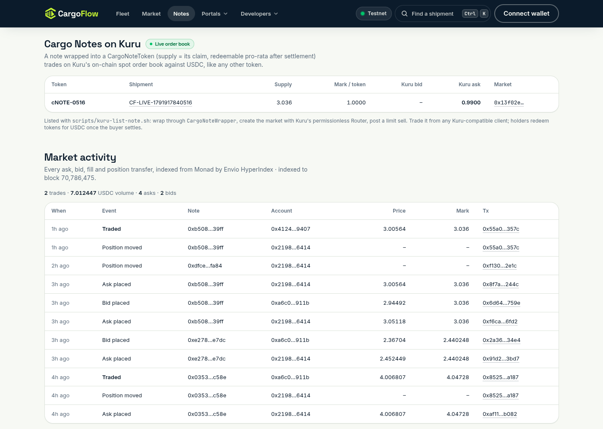</a></p>

**Alchemy:** the hosted API runs on Alchemy's Monad Testnet endpoint as its primary RPC (`"rpc":"primary"`), with the public RPC as the automatic fallback.

<p align="center">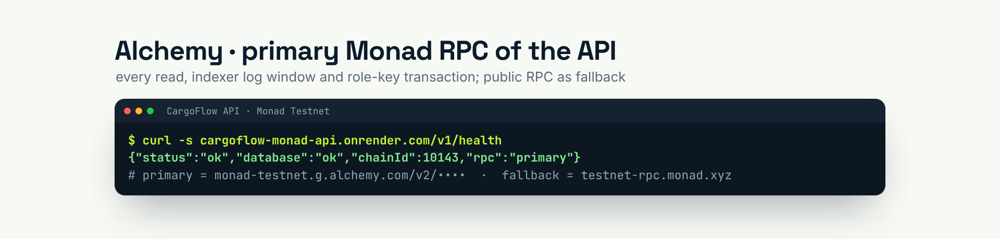</p>

## Measured, not claimed

<p align="center">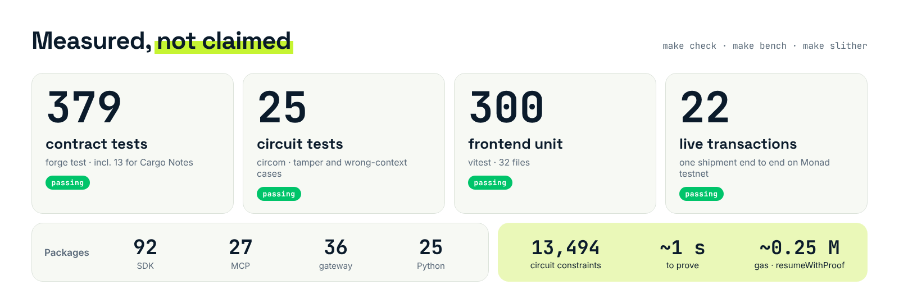</p>

| | |
|---|---|
| Contract tests | 379 passing (unit, fuzz, invariants, real-proof integration, smart-account callers, circuit breaker), including 13 for Cargo Notes |
| Frontend | 300 unit tests passing (vitest, 32 files), including the off-chain mirror of `markPrice` |
| Backend | Every Go package passes except `devicetrust`, whose PEM test roots are not committed (unchanged from upstream) |
| Circuit | 13,494 constraints; proves in about 1 s; tamper and wrong-context tests |
| On chain | One shipment end to end in 22 transactions on Monad Testnet, including a Groth16 verification and a note trade |
| Static analysis | Slither triaged: [`docs/security/slither-triage.md`](docs/security/slither-triage.md), [v3](docs/security/slither-v3.md) |

Every figure is reproducible with `make check`; method and caveats are in [`docs/benchmarks.md`](docs/benchmarks.md).

## Security and what's next

Report vulnerabilities as described in [`SECURITY.md`](SECURITY.md). The threat model is in
[`docs/project/16-security-threat-model.md`](docs/project/16-security-threat-model.md) and the trust boundaries in
[`docs/architecture.md`](docs/architecture.md#trust-boundaries).

### What's next

- **Note liquidity.** A market-maker vault that quotes both sides of every new note around its evidence mark; Kuru
  markets for every wrapped note.
- **Monad mainnet.** Real USDC and the first outside financier; target $1M in notes outstanding within six months.
- **Pilot.** One Indian pharma exporter and one NBFC funding ten shipments, at least three notes traded mid-voyage.
- **Public ZK ceremony and audit.** A multi-party trusted setup for the recovery circuit; an independent audit of the
  core and the note market.
- **Physical logger pilots.** Secure-element boards (P-256 with X.509, already implemented and tested) on real reefer
  loggers.
- **Title and scale.** An MLETR legal opinion on the electronic bill of lading, and a dedicated prover queue.

## Demo video

The Metropolis demo (≤ 3:00) and pitch (≤ 2:00) are cut from the original CargoFlow film (Remotion), re-rendered for Monad and
USDC (the earlier chain's frames are cut) and new Monad recordings added: the note book ticking per block, a bid
filled, and settlement paying the note holder on MonadVision. Shot list, voice-over and the clips to record:
[`docs/submission/VIDEO-SCRIPT.md`](docs/submission/VIDEO-SCRIPT.md).

## Documentation

- [All links](#all-links) · [Docs index](docs/README.md)
- [Role guides](docs/guides/README.md): exporter, financier, buyer, carrier, arbiter
- [Architecture](docs/architecture.md): components, state machine, trust boundaries
- [Backend service, API and guarantees](backend/README.md)
- [Live run on Monad](docs/runs/monad-testnet.md) · [Testnet runbook](docs/runbooks/testnet.md)
- [Submission kit](docs/submission/README.md) · [Video script](docs/submission/VIDEO-SCRIPT.md)
- [Benchmarks](docs/benchmarks.md) and [Slither triage](docs/security/slither-triage.md)
- [Protocol knowledge base](docs/project/README.md)
- [Changelog](CHANGELOG.md), [Contributing](CONTRIBUTING.md), [Security policy](SECURITY.md)

## License

[MIT](LICENSE). The generated Groth16 verifier is GPL-3.0 (see [NOTICE](NOTICE)).
